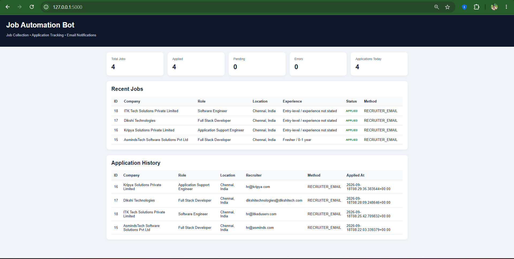

# JobAutomationBot 🚀

An automated job discovery, application tracking, and notification system built with Python. The project collects relevant fresher job opportunities, filters them based on predefined criteria, supports recruiter-email applications, and provides a local dashboard to monitor application activity.

## 📌 Project Overview

JobAutomationBot helps job seekers simplify their job search by automating repetitive tasks such as:

- Collecting job opportunities from public job sources
- Filtering jobs based on role, location, experience, and freshness
- Storing job information in an SQLite database
- Applying through recruiter email when available
- Attaching a resume to application emails
- Tracking application status
- Sending email confirmations and daily summaries
- Displaying job and application statistics through a Flask dashboard
- Running automatically using Windows Task Scheduler

> **Project Status:** Actively developed. The current implementation supports public job collection, recruiter-email applications, tracking, notifications, and a local dashboard.

---

## ✨ Features

### 1. Job Collection

- Collects job listings from supported public job APIs.
- Filters jobs according to configured criteria.
- Identifies relevant fresher and entry-level opportunities.
- Stores job details in SQLite.

### 2. Job Filtering

The filtering system considers:

- Job title and role
- Preferred locations
- Experience requirements
- Job freshness
- Excluded seniority levels
- Available recruiter contact details

### 3. Application Automation

The application engine supports:

- Recruiter-email applications
- Resume attachment
- Configurable daily application limits
- Duplicate application prevention
- Application status tracking

Direct web-form automation is designed to require review where additional verification, login, or user input is necessary.

### 4. Application Tracking

Tracks important application information, including:

- Company name
- Job title
- Job location
- Application method
- Application status
- Application date
- Recruiter email
- Error or processing details

### 5. Email Notifications

The notification system supports:

- Application confirmation emails
- Daily application summaries
- Application status information

### 6. Flask Dashboard

The local dashboard displays:

- Total collected jobs
- Applied jobs
- Pending applications
- Failed applications
- Applications submitted today
- Recent job listings
- Application history

### Dashboard Preview



---

## 🛠️ Technologies Used

| Technology | Purpose |
|---|---|
| Python | Core application development |
| Playwright | Browser automation foundation |
| Flask | Local dashboard |
| SQLite | Job and application storage |
| Requests | API communication |
| SMTP | Email notifications and applications |
| python-dotenv | Environment configuration |
| Windows Task Scheduler | Scheduled execution |
| Git & GitHub | Version control |

---

## 🏗️ Project Architecture

```text
Public Job API
      │
      ▼
Job Collector
      │
      ▼
Job Filtering
(Role, Location, Experience, Freshness)
      │
      ▼
SQLite Database
      │
      ▼
Application Engine
      │
      ├── Recruiter Email Application
      │        │
      │        ▼
      │   Gmail SMTP + Resume
      │
      └── Direct Web Form
               │
               ▼
         Review Required
      │
      ▼
Application Tracking
      │
      ▼
Email Notifications
      │
      ▼
Flask Dashboard

Windows Task Scheduler
          │
          ▼
       main.py
```

---

## 📂 Project Structure

```text
JobAutomationBot/
│
├── applications/
│   ├── __init__.py
│   ├── application_bot.py
│   ├── application_rules.py
│   ├── email_apply.py
│   ├── profile.py
│   └── tracker.py
│
├── data/
│   └── jobs.db
│
├── docs/
│   └── screenshots/
│       └── dashboard.png
│
├── jobs/
│   ├── __init__.py
│   ├── collector.py
│   ├── database.py
│   ├── hopin_collector.py
│   └── view_jobs.py
│
├── notifications/
│   ├── __init__.py
│   └── email.py
│
├── resume/
│   └── Subash_M_Resume.pdf
│
├── logs/
│   └── bot.log
│
├── .env
├── .gitignore
├── config.py
├── dashboard.py
├── main.py
├── requirements.txt
├── README.md
└── run_bot.bat
```

> Personal credentials, resume files, databases, and logs should not be committed to the public repository.

---

## ⚙️ Requirements

- Windows 10 or Windows 11
- Python 3.10 or later
- Git
- Gmail account with SMTP access
- Internet connection

---

## 🚀 Installation

### 1. Clone the Repository

```bash
git clone https://github.com/Subash0512/JobAutomationBot.git
```

### 2. Open the Project Directory

```bash
cd JobAutomationBot
```

### 3. Create a Virtual Environment

```bash
python -m venv venv
```

### 4. Activate the Virtual Environment

```bash
venv\Scripts\activate
```

### 5. Install Dependencies

```bash
pip install -r requirements.txt
```

### 6. Install Playwright Browser

```bash
playwright install chromium
```

---

## 🔐 Configuration

Create a `.env` file in the project root.

Example:

```env
GMAIL_SENDER=your_email@gmail.com
GMAIL_APP_PASSWORD=your_app_password
GMAIL_RECEIVER=your_email@gmail.com
```

Use a Gmail App Password rather than your regular Gmail password.

**Important:**

- Never publish your `.env` file.
- Never expose API keys or email credentials.
- Revoke exposed credentials immediately.
- Keep personal information in local configuration files.

---

## 📄 Resume Configuration

Place your resume in the local `resume` directory.

Example:

```text
resume/Subash_M_Resume.pdf
```

Update the resume path in the application configuration if required.

---

## ▶️ Running the Bot

From the project directory:

```bash
venv\Scripts\python.exe main.py
```

The bot will:

1. Collect available job listings.
2. Filter relevant opportunities.
3. Save jobs to the database.
4. Process eligible applications.
5. Track application results.
6. Send email notifications.

---

## 📊 Running the Dashboard

Start the Flask dashboard:

```bash
venv\Scripts\python.exe dashboard.py
```

Open the following address in your browser:

```text
http://127.0.0.1:5000
```

Keep the terminal window running while using the dashboard.

Press `CTRL+C` in the terminal to stop the dashboard.

---

## ⏰ Scheduled Execution

The project can be configured to run automatically using Windows Task Scheduler.

The batch file used for execution is:

```text
run_bot.bat
```

The scheduled task should be configured according to the user's preferred execution frequency and Windows permissions.

---

## 🛡️ Safety and Responsible Automation

This project is designed with controlled automation in mind.

- Uses configurable application limits.
- Avoids storing sensitive credentials in Git.
- Does not bypass CAPTCHA or security verification.
- Does not guess application answers.
- Requires review for application flows that need additional user input.
- Does not automate restricted LinkedIn login or scraping workflows.
- Uses recruiter-email applications when suitable contact information is available.

Always review application content and ensure that applications comply with the policies of the relevant job platform.

---

## 🔮 Future Improvements

Planned improvements include:

- Improved job-source integrations
- Better duplicate detection
- Resume-to-job matching
- Keyword-based skill matching
- Application analytics
- Enhanced dashboard filters
- Application reminder notifications
- Improved direct web-form review workflow
- More configurable job preferences
- Unit and integration testing
- Deployment documentation

---

## 🧠 Skills Demonstrated

This project demonstrates practical experience with:

- Python programming
- Object-oriented programming
- REST API integration
- Web automation concepts
- Database management
- SQLite queries
- Email automation
- Flask web development
- Environment variable management
- Task scheduling
- Git and GitHub
- Error handling
- Automation workflow design

---

## 👨‍💻 Author

**Subash M**

B.E. Information Technology Graduate

GitHub: [Subash0512](https://github.com/Subash0512)

---

## 📜 License

This project is intended for educational and personal portfolio purposes.

Add an appropriate open-source license before distributing the project for public reuse.